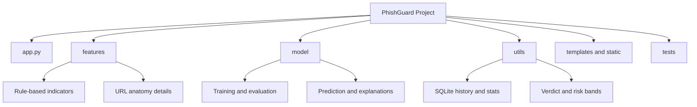
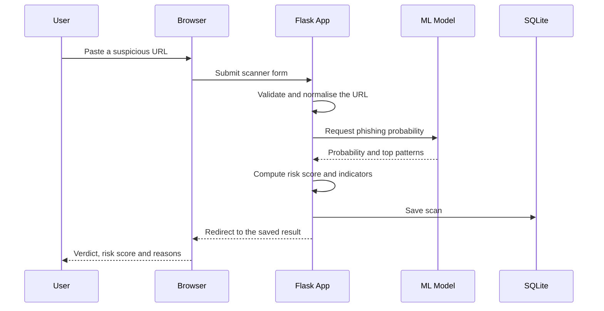
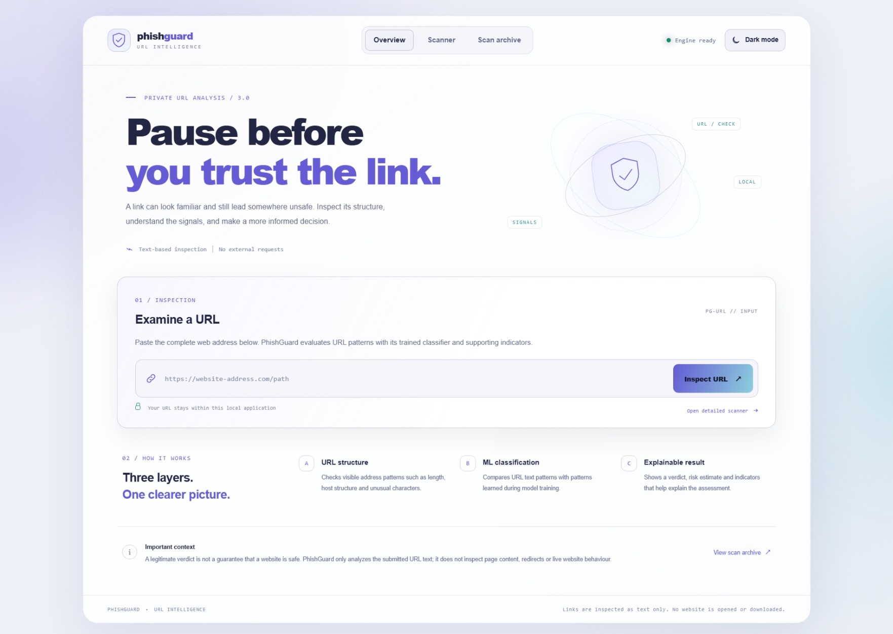
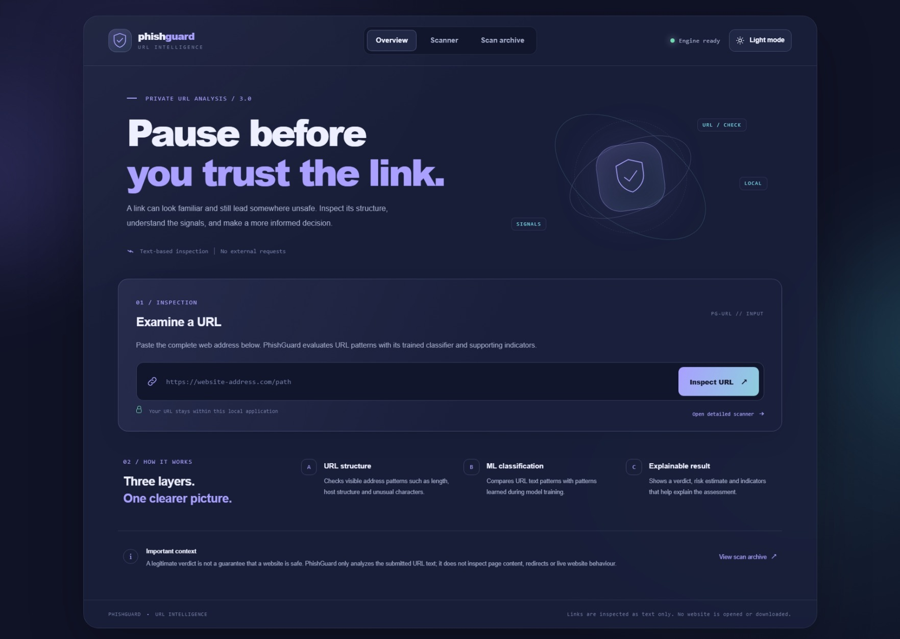
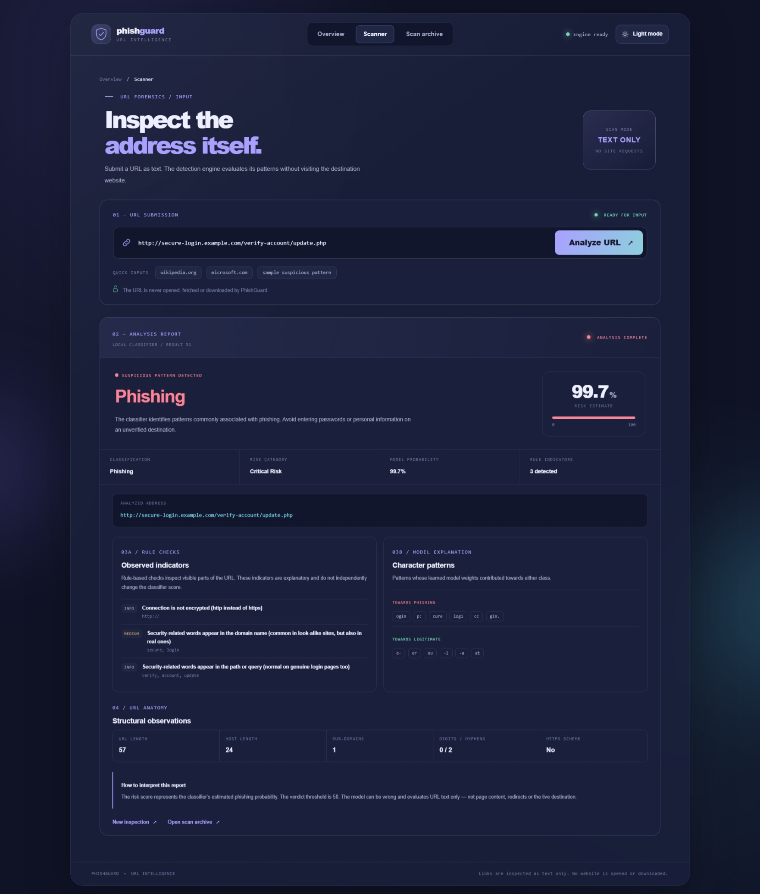
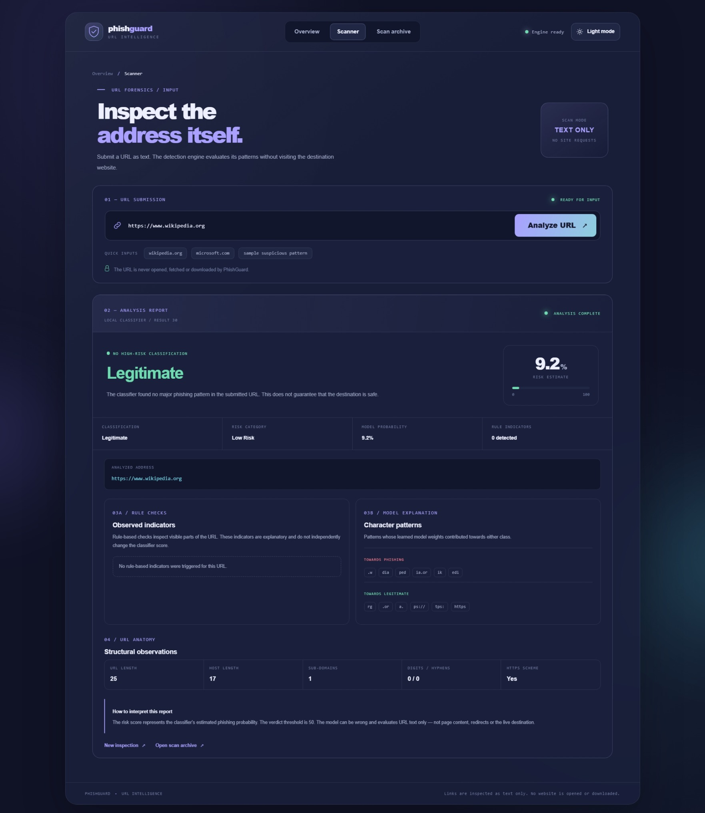
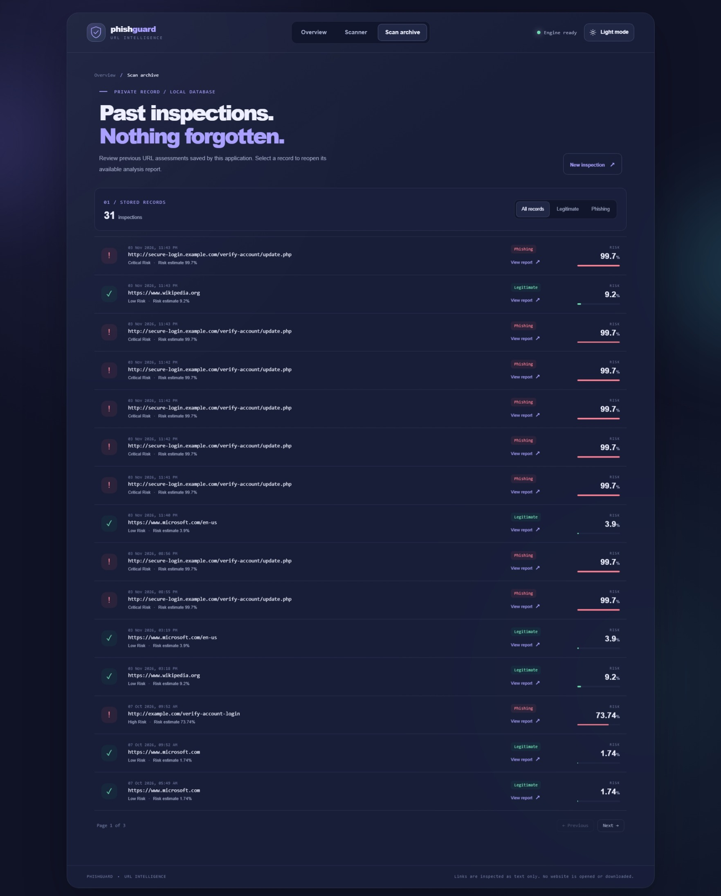

# 🛡️ PhishGuard: AI-Powered Phishing Detection and Risk Analysis

**Status:** 🟢 Working Prototype &nbsp;·&nbsp; Cybersecurity &nbsp;·&nbsp; BCA Minor Project &nbsp;·&nbsp; 2026

[](https://github.com/muskan-85/PhishGuard)
[](#-project-preview)
[](https://www.linkedin.com/in/muskan-9b5b99389)

> **A local, explainable web app that scores a link for phishing risk using machine learning, and explains its reasons, without ever opening the link.**

---

## ⚠️ Caution & Disclaimers

> **IMPORTANT — EDUCATIONAL USE ONLY**
> PhishGuard is an academic prototype built for learning and demonstration. It is not a replacement for professional security tools or practices.

**Cautions:**
- PhishGuard analyses the **text** of a URL. It never visits, opens or downloads the address, but its output is advice, not a guarantee.
- Do not rely on it to decide whether a link is safe for an organisation or to protect real accounts.
- The model was trained on one 10,000-URL dataset, so its accuracy on live traffic is not guaranteed.

**Notes:**
- No real malware or malicious payloads are included in this repository.
- All accuracy figures come from a held-out test split of the same dataset.

---

## 🛡️ Introduction

Phishing is one of the most common ways attackers steal passwords and money. A fake login page or message copies a trusted brand and hopes the visitor will type their details into it. **PhishGuard** checks a web address before anyone clicks it. It returns a **Legitimate** or **Phishing** verdict, a 0–100 risk score, and a list of plain-language reasons.

**What is a phishing URL?**
A link whose address is built to look trustworthy, such as a lookalike domain with extra words stacked in front of it, while the real destination is somewhere else.

**Why not just use a blocklist?**
A blocklist only knows about sites that have already been reported. PhishGuard learns character patterns from labelled examples and combines them with rule-based checks, so it can score an address it has never seen. It can also be wrong, which is why every result shows the reasons behind it.

---

## 🚀 Installation & Running

**Requirements:** Python 3.11+ (tested with 3.13) · Windows batch scripts included · Virtual Environment (recommended)

### Step 1 — Clone the Repository
```bash
git clone https://github.com/muskan-85/PhishGuard
cd PhishGuard
```

### Step 2 — Set Up the Environment
On Windows, run the one-time setup script:
```bat
setup_windows.bat
```

Or do it manually:
```powershell
python -m venv .venv
.venv\Scripts\Activate.ps1
pip install -r requirements.txt
```

### Step 3 — Run the Application
```bat
run.bat
```

Or run `python app.py` directly, then open **http://127.0.0.1:5000** in your browser.

> **Important: scikit-learn version.** The saved model is a pickle and must be loaded with the same scikit-learn version that trained it (1.9.1, pinned in `requirements.txt`). If the versions differ, the header shows "Engine warning" or "Engine offline" with a message, rather than unreliable results. Retraining is covered in the Retraining section below.

### Step 4 (Optional) — Run the Tests
```bash
python -m unittest discover -s tests -v
```

---

## 🔁 Retraining (Optional)

The trained model (`model/phishing_model.pkl`) is included, so the app runs without retraining. `run.bat` only trains a model automatically when the model file is missing.

**The training dataset is not included in this repository.** Retraining needs the source file `dataset/data_bal - 20000.xlsx`, with the columns `URLs` and `Labels` (0 = legitimate, 1 = phishing). Place it in a `dataset` folder inside the project, then run:

```bat
python scripts\prepare_dataset.py
python model\train_model.py
```

The first command creates the balanced 10,000-URL file `dataset/phishguard_balanced_10000.csv`. The second trains the model and writes the new model file and `model/model_report.json`. Without the source file, `train_model.py` stops with a "dataset not found" error.

---

## 📊 Folder Structure



| File / Folder | Role |
|---|---|
| `app.py` | The **Gateway**: Flask routes for the Dashboard, URL Scanner and Scan History |
| `model/` | The **Engine**: training script, saved classifier, prediction and classifier explanations |
| `features/` | The **Explainer**: human-readable rule checks and URL structure details |
| `utils/` | The **Toolkit**: input validation, risk bands and SQLite database helpers |
| `templates/`, `static/` | The **Interface**: HTML, CSS and JavaScript that work offline with no CDN |
| `scripts/` | Builds the balanced 10,000-URL training dataset (needs the source file, see Retraining) |
| `tests/` | Automated tests for validation, predictions, pages and the database |
| `Screenshots/` | Interface previews used in this README |

---

## 📌 Project Information

| Category | Details |
|---|---|
| Project Name | PhishGuard |
| Project Type | Local Web Application (Flask) |
| Domain | Phishing Detection & Explainable Risk Analysis |
| Language | Python 3 |
| Interface | Browser-based (served on 127.0.0.1) |
| Status | Working Prototype |
| Context | BCA Minor Project |
| Developed By | Muskan |
| Year | 2026 |

---

## 🛠️ Technologies & Techniques

| Category | Technology | Purpose |
|---|---|---|
| Language | Python 3.11+ | Application logic and the ML pipeline |
| Web Framework | Flask | Routes, pages and security headers |
| Machine Learning | scikit-learn | TF-IDF features and Logistic Regression classifier |
| Data Handling | pandas, NumPy, openpyxl | Dataset cleaning, balancing and Excel import |
| Model Storage | joblib | Saves the fitted vectorizer and classifier together |
| Database | SQLite | Scan history and dashboard statistics |
| Frontend | HTML, CSS, vanilla JavaScript | Responsive interface with no external dependencies |

**Model Pipeline:** URL text → character TF-IDF (2–5-grams, 60,000 features) → Logistic Regression → phishing probability → risk score (probability × 100)

---

## ✨ Features & Functions

### 1. 📊 Dashboard
- Live scan statistics from the local database
- The model's training results, shown separately from live counts

### 2. 🔍 URL Scanner
- Input validation: http or https only, a real domain name, no spaces, at most 2,048 characters
- Adds `https://` automatically when no scheme is typed
- Returns the verdict, the 0–100 risk score and a risk band (Low, Medium, High or Critical)
- Shows the URL anatomy: length, hostname, sub-domains, digits, special characters, custom port and percent-encoding

### 3. 🧠 Explainable Results
- **Rule-based indicators:** raw IP address as host, no HTTPS, `@` in the address, link shorteners, punycode, many sub-domains, security words in the domain or path, custom ports, risky file extensions and injection-style patterns. Each one shows the exact text it matched.
- **Classifier signals:** the character patterns that pushed the model's score the most, towards phishing or towards legitimate.
- These two explanations are kept apart, and neither one changes the score.

### 4. 🗂️ Scan History
- Paginated list of every scan, 15 per page
- Filter by *Phishing* or *Legitimate*
- Reopen any past scan with its full breakdown

### 5. 🧪 Model & Dataset
- Balanced dataset of 10,000 unique URLs (5,000 per class, fixed seed for reproducibility)
- Stratified 80/20 split, with the vectorizer fitted on the training data only
- Training adds `www.`-toggled copies of training URLs to remove a shortcut found in the source data

### 6. 🔒 Security Design
- URLs are never fetched and are displayed as escaped text, never as clickable links
- Server-side validation, with Flask debug mode off by default
- Security headers are set, including a Content Security Policy, `X-Frame-Options: DENY` and `Referrer-Policy: no-referrer`
- The server listens on `127.0.0.1` only, and no API keys or secrets are used

---

## 📈 System Flow



---

## 📈 Model Results

Measured on 2,000 URLs the model never saw during training. Every figure below is copied from `model/model_report.json`:

| Metric | Value |
|---|---|
| Accuracy | 93.5 % |
| Precision (phishing) | 95.9 % |
| Recall (phishing) | 90.9 % |
| F1-score | 93.3 % |
| ROC-AUC | 0.980 |

**Confusion matrix:** 961 legitimate correctly identified, 39 legitimate flagged as phishing, 91 phishing missed, 909 phishing caught.

### A Dataset Bias That Was Found and Handled

In the source data, 95.8 % of legitimate URLs contain `www.` but only 12.2 % of phishing URLs do, so a model can learn "no `www.` means phishing" as a shortcut. Training therefore adds `www.`-toggled copies of the training URLs only (`--no-augment` turns this off). The training report records 93.1 % accuracy and 95.1 % legitimate recall on the test URLs with `www.` removed.

---

## 🖼️ Project Preview

<table>
<tr>
<td width="50%"></td>
<td width="50%"></td>
</tr>
<tr>
<td width="50%"></td>
<td width="50%"></td>
</tr>
<tr>
<td width="50%"></td>
<td width="50%"></td>
</tr>
</table>

---

## 🔐 Security Policy

- **Project status:** PhishGuard is an academic project built for educational and demonstration purposes.
- **Reporting a vulnerability:** Report security issues privately to the repository owner through GitHub. Please avoid sharing vulnerability details publicly until the issue has been reviewed.
- **Scope:** The project analyses submitted URL text for phishing indicators. It does not visit or open submitted URLs.

The same policy is kept in `SECURITY.md`.

---

## ⚠️ Known Limitations

- Only the URL text is analysed. There is no page-content check, DNS or WHOIS lookup, domain-age check or blocklist.
- Phishing hosted on a trusted domain, such as a file on a large cloud service, can be missed. Unusual but legitimate URLs can be flagged.
- The training URLs are mostly deep links, so bare home pages such as `google.com` can land in the Medium risk band even though they are classed as Legitimate.
- The accuracy figures come from one dataset and do not guarantee performance on real-world traffic.
- The model file depends on the scikit-learn version (see Installation).
- The development server is suitable for demonstration, not for production.

---

## 🎓 What I Learned

**Context:** Built as a BCA minor project, focused on applied cybersecurity and machine learning.

**Learning Outcomes:**
- Built a text-classification pipeline with character n-gram TF-IDF and Logistic Regression
- Evaluated the model with precision, recall, F1 and ROC-AUC, and understood why accuracy alone is not enough
- Found and fixed a dataset shortcut, and checked for train/test leakage
- Made a model explainable by reading its coefficients, and kept rule-based reasons separate from the score
- Applied secure web practices: input validation, escaped output, security headers and a local-only server

---

## 🔮 Future Enhancements

- **Domain intelligence:** Add WHOIS and domain-age checks to the analysis
- **Blocklist integration:** Check public phishing feeds alongside the model
- **Retraining:** Train on a larger and more recent dataset and track results over time
- **Browser extension:** Show the verdict on a link before it is clicked
- **Containerisation:** Package the app with Docker for easier setup on other machines

---

## 📜 License

Copyright (c) 2026 Muskan. All rights reserved.

This project and its source code are the intellectual property of the author. No permission is granted to copy, modify, distribute, publish or use this project, in whole or in part, without prior written permission from the author. Third-party libraries, tools, datasets and other components remain subject to their respective licences and terms.

---

## 🏷️ Tags

`#CyberSecurity` `#Phishing` `#Python` `#Flask` `#MachineLearning` `#ScikitLearn` `#TFIDF` `#LogisticRegression` `#URLAnalysis` `#ExplainableAI` `#MinorProject`

---

**Muskan © 2026**